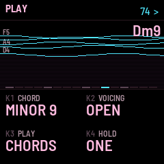

# VOID manual

VOID is an ambient instrument for the M-VAVE FM-1. The keys play slow drones as chords that follow the note you
press. Around them run a melody sequencer with 24 sounds, a bass, a drum machine with four kits, high FM "shards", a
shimmer cloud and echo, three LFOs, a tape stage and eight scenes.

1. Install
2. The screen
3. The buttons and knobs
4. Playing chords
5. The sequencers
6. Scenes and saving
7. MIDI
8. Troubleshooting

---

## 1. Install

To install from the browser, use Chrome or Edge. Connect the FM-1 by USB, open the install page and press Install.
Allow MIDI when the browser asks, and don't unplug the cable while it writes.

To install from a terminal, run `python3 fm1-base/tools/fm1_install.py void-VERSION.fwsc`.

To go back to the stock firmware, use the install page's last section, which writes M-VAVE's own firmware back.

---

## 2. The screen

- **Top line:** the page's name, the tempo, and `>` while the sequencers run (`FRZ` while the cloud is frozen). When
  you press something, it briefly shows what changed.
- **Middle:** what the page is about. It shows the "river" of sounding drones (each line one voice; brighter means
  louder), the drum grid, the melody roll, the bass steps, the chord sequence, the filter curve, an LFO's wave, the
  mixer, or the scenes.
- **Bottom:** four settings, one for each of the knobs K1 to K4. The one you just turned lights up.

---

## 3. The buttons and knobs

Each button opens a group of pages. Press it again to go to the group's next page, or turn **SELECT** to scroll the
group's pages.

| Button | Pages |
|---|---|
| HOME | PLAY (chord, voicing, chords/single, one/layer) · SOUND (attack, release, detune, cutoff) · SOUND II (preset, tone, motion, random drone) · SPACE (cloud, shimmer, echo, freeze) · MIXER · MIXER II |
| SEL | HARMONY (root, scale, chord, voicing) · KEYS (chords/single, one/layer, latch, spread) |
| EDIT | DRONE (preset, choir, partials, breath) · DRONE II (timbre, tone, detune, motion) · DRONE III (attack, release, spread, random drone) · SHARDS |
| ENV | SHAPE (attack, release, swell, spread) · FILTER (type, cutoff, resonance, drive) |
| LFO | LFO 1 · LFO 2 · LFO 3 (shape, rate, depth, target) |
| FX | MOVES (swell, sparkle, blur, sink) · DRONE FX (attack, release, detune, motion) · FILTER · CLOUD (size, amount, shimmer, damping) · ECHO · TAPE |
| ARP | MELODY · MELODY SOUND (sound, random sound, tone, glide) · MELODY STEP · MELODY TOOLS · BASS · BASS SOUND · BASS OCTAVE |
| SEQ | DRUMS · DRUM TRACK · DRUM FEEL · DRUM TOOLS (evolve, kit, level, space) · CHORD SEQ |
| GLO | GLOBAL (tempo, swing, clock, MIDI channel) |
| SAVE | SCENES |

- **RANDOM DRONE** and **RANDOM SOUND:** turn the knob and every turn rolls a new drone, or a new melody sound.
- **EVOLVE** (DRUM TOOLS): while it plays, a hat, perc or clap step comes or goes every two bars.
- **ALGO** knob: the chord type on any page. **PRESET** knob: the drone preset on any page.
- **PLAY:** starts and stops the melody, bass, drums, shards and chord sequence.
- **REC:** freezes the cloud (an endless pad of what's sounding). On a step page it enters a rest instead (see 5).
- **OCT- / OCT+:** move the keys an octave down or up (−3 to +3). Press both together to let go of every drone.

---

## 4. Playing chords

On any page that isn't a step page, the keys play the drones. The lit keys are the notes of the key you've chosen,
and the bright ones are the drones that are holding.

- **CHORD** (HOME's PLAY page, or the ALGO knob): 33 chords built on the note you press, among them major, minor,
  sus2, sus4, add9, minor add9, 6/9, maj7, minor 7, maj9, minor 9, dom 9, minor 11, maj7#11, maj13 and quartal. After
  them come 12 KEY chords (KEY TRIAD, KEY 7TH, KEY 9TH, KEY ADD9 and others). These snap the key you press to the
  nearest note of the scale and stack the scale on it, so every chord stays in key.
- **VOICING:** close, open, drop 2 or wide.
- **PLAY: CHORDS / SINGLE:** a whole chord on each key, or just the note.
- **HOLD: ONE / LAYER:** ONE keeps only the last chord, so a new key replaces the old one. LAYER stacks them, up to 8
  drone voices.
- **LATCH:** with latch on, a chord rings on after you let go. Press its key again to let go of it.
- **ROOT** and **SCALE** (SEL's HARMONY page): the key. The bass, the shards and the "in key" chords follow it.

The bass's R steps and the shards follow whatever chord is held. When nothing is held, they use the key's own chord.

---

## 5. The sequencers

Every sequencer has 16 steps (the chord sequence has 8). On a step page, the white keys are the steps.

**Melody** (ARP): turn K1 on MELODY STEP to move the step cursor, or play a key. The note goes into the cursor's step,
and the cursor moves on. **REC** puts a rest there. MELODY TOOLS has GENERATE and CLEAR (turn twice within two seconds
to do it), SHIFT (turn left or right to move the whole melody a step) and HUMANIZE. MELODY's SOUND picks one of 24
sounds: electric pianos, toy piano, organ, clav, bells, vibraphone, marimba, kalimba, music box, steel drum, pluck,
harp, flute, ocarina, a voice, saw and supersaw leads, acid, a sine lead and a warm pad.

**Bass** (ARP's BASS pages): a key enters that note into the step. **REC** enters **R**, a step that plays the root
of the chord held, so the bass follows your chords. Hold **OCT-** and press **REC** to turn the step off. **R PLAYS**
picks what R plays: the root, fifths, an arpeggio up or down the chord, octaves, or a random chord note. BASS SOUND
has 8 models: sine, triangle, square, saw, reese, sub, organ and FM.

**Drums** (SEQ): the white keys toggle the steps of the selected track: off, then full, then soft, then off again. The
black keys, from left to right:

| Black key | Does |
|---|---|
| 1–6 (F#3 to F#4) | pick the track: kick, snare, clap, hat, open hat, perc |
| 7 (G#4) | a fill over the next half bar |
| 8 (A#4) | swing: 0, 25, 50, 75 % |
| 9 (C#5) | the next kit (SOFT, LOFI, 808, GLITCH) |
| 10 (D#5) | press twice: a new groove |
| 11 (F#5) | press twice: clear this track (hold OCT- too: every track) |

DRUM TRACK sets the selected track's tune, decay and volume. DRUM FEEL has swing, humanize, space (how much reaches
the cloud) and pump (the drones duck on the kick).

**Chord sequence** (SEQ's CHORD SEQ): eight chords, each played for 1, 2, 4 or 8 bars while the sequencers run. A key
enters the chord on its note of the key. **REC** empties a step, and empty steps are skipped. Turn PLAYS on to hear it.

---

## 6. Scenes and saving

Press **SAVE** to open SCENES. The first 8 white keys are 8 scenes. Each scene keeps every setting, every pattern and
the chord that is holding.

- **Store:** hold SAVE and press a white key.
- **Recall:** press a white key. MORPH (K1) glides the settings over 0 to 60 seconds, so a scene change can be a slow
  fade.
- **Keep everything for the next power-on:** hold SAVE for a second on any other page. The top line says **STATE
  SAVED**.

---

## 7. MIDI

- **Notes in** (USB or TRS) play the drones like the keys. **MIDI IN** on GLOBAL chooses the channel, or ALL.
- **CC 1** (the mod wheel) sets the cutoff. **CC 64** (the sustain pedal) freezes the cloud.
- **CLOCK: MIDI** follows an external clock's tempo, and Start/Stop starts and stops the sequencers.

---

## 8. Troubleshooting

If you hear no sound, turn MASTER up and press a key. The drones swell in slowly unless ATTACK is low.

If it crackles with many chords layered, VOID drops a few drone voices by itself until the sound is clean again.

If the FM-1 doesn't start after an install, it starts in SAFE MODE after two failed starts. USB still works then, so
the install page can install again or put the stock firmware back. To put the FM-1 in update mode yourself, hold REC
while you switch it on.
